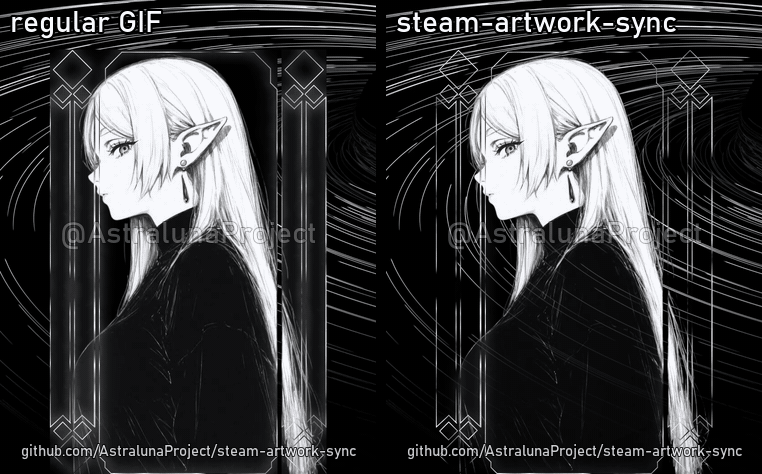
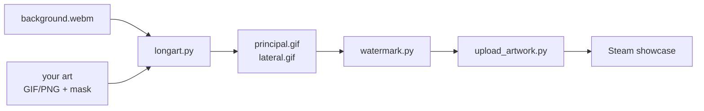

<div align="center">

# steam-artwork-sync

**Arte animado para perfil de Steam que se mantiene sincronizado con tu fondo animado.**

[English](README.md) · [Português](README.pt-BR.md) · [Español](README.es.md)




<sub>Izquierda: el GIF normal del artista. Derecha: el mismo arte creado con steam-artwork-sync. Demo: arte "Frieren Steam Profile (FREE)" de ruekae (de uso gratuito), sobre el fondo animado "Black Hole" de la Tienda de puntos de Steam.</sub>

</div>

---

## Por qué

Steam reproduce el fondo del perfil (un video WebM) y el arte de la vitrina (GIF) **de forma independiente**. Un long art pensado para continuar el fondo se sale de lugar en segundos, y todas las herramientas que existen solo *cortan* los GIF en piezas de la vitrina.

**steam-artwork-sync incrusta el fondo en el arte.** Cada GIF lleva el recorte exacto del video que está detrás, con retardos de fotograma que suman el bucle del video, así que la vitrina parece una ventana recortada en el fondo.

## Funciones

| | |
|---|---|
| 🎞️ **Long art sincronizado** | Recorta el fondo en la posición de la vitrina (principal de 506 px + lateral de 100 px, o una pieza destacada de 630 px), coloca tu arte encima y reajusta los tiempos a un bucle del fondo |
| 📦 **Se ajusta a los límites de Steam** | Cada pieza por debajo de 5 MB; trailer del GIF modificado para que Steam lo muestre a ancho completo |
| 🔍 **Encuentra el fondo adecuado** | Explora la API pública de la Tienda de puntos y clasifica los fondos animados por oscuridad y por movimiento en el centro vs. los laterales |
| ✨ **Retoques** | Movimiento más fluido dentro del límite de tamaño, rellenar con inpaint un divisor, dejar en negro el fondo debajo del video, eliminar texto incrustado |
| 💧 **Marca de agua** | Enlace del perfil en la parte inferior (rotado en las piezas laterales) más una etiqueta central; sincronización de fotogramas intacta |
| ⬆️ **Subida** | Envía al formulario de obras de arte de Steam con el truco de tamaño `1000×1` que hace que el arte se renderice a ancho completo |

## Cómo funciona



Medido en un perfil real en una ventana de 1920 px: pieza principal en **x 495, y 256** del video de fondo, pieza lateral en **x 1010**.

## Inicio rápido

```bash
pip install -r requirements.txt          # además de ffmpeg en el PATH

python steam_artwork_sync/longart.py --background background.webm --art art.gif --out out/
python steam_artwork_sync/watermark.py --input out/principal.gif --out out/main_marked.gif \
    --text "steamcommunity.com/id/<you>"
```

Cada herramienta tiene `--help`. Los archivos de salida y las claves del reporte mantienen sus nombres originales (`principal.gif`, `lateral.gif`, `relatorio.json`).

## Herramientas

| herramienta | qué hace |
|---|---|
| `longart.py` | crea las piezas sincronizadas de la vitrina a partir de un video de fondo y tu arte |
| `watermark.py` | agrega el enlace del perfil y una etiqueta central opcional |
| `interpolate.py` | animación más fluida dentro del límite de 5 MB |
| `erase_strip.py` | rellena con inpaint una franja rectangular (divisores, etiquetas) fotograma a fotograma |
| `black_background.py` | conserva el arte y deja en negro su fondo animado |
| `clean_gif.py` | elimina texto incrustado por color; escala de grises opcional conservando el color en una región |
| `upload_artwork.py` | sube a Steam con el truco de ancho completo |
| `scan_dark.py` · `catalog.py` · `motion.py` | exploran y clasifican fondos de la Tienda de puntos |

## Subida

`upload_artwork.py` necesita los campos ocultos de `steamcommunity.com/sharedfiles/edititem/767/3/`, leídos mientras tienes la sesión iniciada. Guárdalos en un archivo JSON y pásalo con `--fields`; nunca los pongas en la línea de comandos. El token del formulario expira después de unas **24 horas**: una subida que devuelve `fileuploadsuccess=15` suele significar un token vencido, así que vuelve a leer los campos.

## Límites conocidos

- Steam no inicia el fondo y los GIF en el mismo instante; los bucles cortos (1–2 s) se recuperan solos.
- En pantallas de más de 1920 px, Steam escala el fondo pero no las vitrinas, así que la sincronización se mantiene para un solo ancho. Genera para el ancho que usan tus visitantes.
- Los temas de perfil de juego agregan un panel de vidrio esmerilado (`backdrop-filter: blur(20px)`) alrededor de las vitrinas; solo el arte en sí muestra el fondo nítido.

## Licencia

[MIT](LICENSE) © Overwind · Hecho por [@AstralunaProject](https://github.com/AstralunaProject)