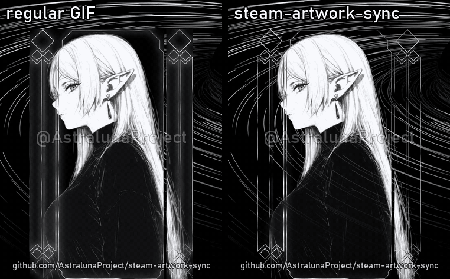
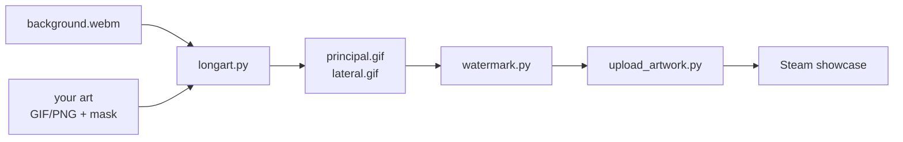

<div align="center">

# steam-artwork-sync

**Animated Steam profile artwork that stays in sync with your animated background.**

[English](README.md) · [Português](README.pt-BR.md) · [Español](README.es.md)




<sub>Left: the artist's regular GIF. Right: the same art built with steam-artwork-sync. Demo: "Frieren Steam Profile (FREE)" artwork by ruekae (free to use), over the "Black Hole" animated background from the Steam Points Shop.</sub>

</div>

---

## Why

Steam plays the profile background (a WebM video) and the showcase artwork (GIFs) **independently**. A long art meant to continue the background drifts out of place within seconds, and every tool out there only *cuts* GIFs into showcase pieces.

**steam-artwork-sync bakes the background into the artwork.** Each GIF carries the exact crop of the video behind it, with frame delays that add up to the video's loop, so the showcase looks like a window cut into the background.

## Features

| | |
|---|---|
| 🎞️ **Synced long art** | Crops the background at the showcase position (main 506 px + side 100 px, or one 630 px featured piece), lays your art on top, retimes it to one background loop |
| 📦 **Fits Steam's limits** | Every piece under 5 MB; GIF trailer patched so Steam shows it at full width |
| 🔍 **Find the right background** | Scans the public Points Shop API, ranks animated backgrounds by darkness and by motion in the centre vs. the sides |
| ✨ **Touch-ups** | Smoother motion inside the size budget, inpaint a divider, black out the background below the video, remove baked-in text |
| 💧 **Watermark** | Profile link along the bottom (rotated on side pieces) plus a centre tag; frame timing untouched |
| ⬆️ **Upload** | Posts to Steam's artwork form with the `1000×1` size trick that makes artwork render full width |

## How it works



Measured on a real profile in a 1920 px window: main piece at **x 495, y 256** of the background video, side piece at **x 1010**.

## Quick start

```bash
pip install -r requirements.txt          # plus ffmpeg on PATH

python steam_artwork_sync/longart.py --background background.webm --art art.gif --out out/
python steam_artwork_sync/watermark.py --input out/principal.gif --out out/main_marked.gif \
    --text "steamcommunity.com/id/<you>"
```

Every tool has `--help`. Output files and report keys keep their original names (`principal.gif`, `lateral.gif`, `relatorio.json`).

## Tools

| tool | what it does |
|---|---|
| `longart.py` | builds the synced showcase pieces from a background video and your art |
| `watermark.py` | adds the profile link and an optional centre tag |
| `interpolate.py` | smoother animation within the 5 MB budget |
| `erase_strip.py` | inpaints a rectangular strip (dividers, labels) frame by frame |
| `black_background.py` | keeps the art, turns its animated background to black |
| `clean_gif.py` | removes baked-in text by colour, optional grayscale with colour kept in a region |
| `upload_artwork.py` | uploads to Steam with the full-width trick |
| `scan_dark.py` · `catalog.py` · `motion.py` | browse and rank Points Shop backgrounds |

## Uploading

`upload_artwork.py` needs the hidden fields of `steamcommunity.com/sharedfiles/edititem/767/3/`, read while you are logged in. Save them to a JSON file and pass it with `--fields`; never put them on the command line. The form token expires after about **24 hours**: an upload that returns `fileuploadsuccess=15` usually means a stale token, so read the fields again.

## Known limits

- Steam does not start the background and the GIFs at the same moment; short loops (1–2 s) recover on their own.
- On screens wider than 1920 px Steam scales the background but not the showcases, so sync holds for one width. Build for the width your visitors use.
- Game profile themes add a frosted-glass panel (`backdrop-filter: blur(20px)`) around showcases; only the artwork itself shows the background sharp.

## License

[MIT](LICENSE) © Overwind · Made by [@AstralunaProject](https://github.com/AstralunaProject)
