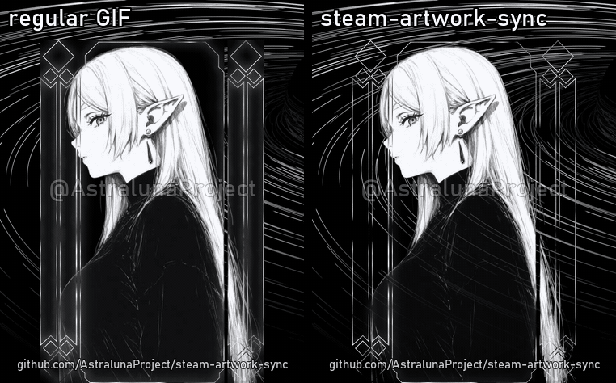
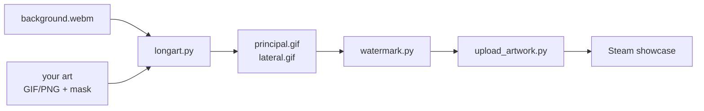

<div align="center">

# steam-artwork-sync

**Arte animada de perfil da Steam que se mantém sincronizada com seu plano de fundo animado.**

[English](README.md) · [Português](README.pt-BR.md) · [Español](README.es.md)




<sub>Esquerda: o GIF normal do artista. Direita: a mesma arte feita com o steam-artwork-sync. Demo: arte "Frieren Steam Profile (FREE)" de ruekae (uso gratuito), sobre o plano de fundo animado "Black Hole" da Loja de Pontos da Steam.</sub>

</div>

---

## Por quê

A Steam reproduz o plano de fundo do perfil (um vídeo WebM) e a arte da vitrine (GIFs) **de forma independente**. Uma long art feita para continuar o plano de fundo sai do lugar em segundos, e todas as ferramentas por aí apenas *cortam* GIFs em peças da vitrine.

**O steam-artwork-sync embute o plano de fundo na arte.** Cada GIF carrega o recorte exato do vídeo atrás dele, com atrasos de quadro que somam o loop do vídeo, de modo que a vitrine parece uma janela recortada no plano de fundo.

## Recursos

| | |
|---|---|
| 🎞️ **Long art sincronizada** | Recorta o plano de fundo na posição da vitrine (principal 506 px + lateral 100 px, ou uma peça em destaque de 630 px), coloca sua arte por cima e ajusta o tempo para um loop do plano de fundo |
| 📦 **Cabe nos limites da Steam** | Cada peça abaixo de 5 MB; trailer do GIF alterado para a Steam exibir em largura total |
| 🔍 **Encontre o plano de fundo certo** | Varre a API pública da Loja de Pontos e ranqueia planos de fundo animados por escuridão e por movimento no centro vs. nas laterais |
| ✨ **Retoques** | Movimento mais fluido dentro do limite de tamanho, fazer inpaint de uma divisória, deixar preto o fundo abaixo do vídeo, remover texto embutido |
| 💧 **Marca d'água** | Link do perfil na parte inferior (rotacionado nas peças laterais) mais uma tag central; temporização dos quadros intacta |
| ⬆️ **Envio** | Envia para o formulário de artes da Steam com o truque de tamanho `1000×1` que faz a arte renderizar em largura total |

## Como funciona



Medido em um perfil real em uma janela de 1920 px: peça principal em **x 495, y 256** do vídeo de fundo, peça lateral em **x 1010**.

## Início rápido

```bash
pip install -r requirements.txt          # além do ffmpeg no PATH

python steam_artwork_sync/longart.py --background background.webm --art art.gif --out out/
python steam_artwork_sync/watermark.py --input out/principal.gif --out out/main_marked.gif \
    --text "steamcommunity.com/id/<you>"
```

Cada ferramenta tem `--help`. Os arquivos de saída e as chaves do relatório mantêm seus nomes originais (`principal.gif`, `lateral.gif`, `relatorio.json`).

## Ferramentas

| ferramenta | o que faz |
|---|---|
| `longart.py` | gera as peças sincronizadas da vitrine a partir de um vídeo de fundo e da sua arte |
| `watermark.py` | adiciona o link do perfil e uma tag central opcional |
| `interpolate.py` | animação mais fluida dentro do limite de 5 MB |
| `erase_strip.py` | faz inpaint de uma faixa retangular (divisórias, rótulos) quadro a quadro |
| `black_background.py` | mantém a arte e deixa seu fundo animado preto |
| `clean_gif.py` | remove texto embutido por cor; escala de cinza opcional mantendo a cor em uma região |
| `upload_artwork.py` | envia para a Steam com o truque de largura total |
| `scan_dark.py` · `catalog.py` · `motion.py` | exploram e ranqueiam planos de fundo da Loja de Pontos |

## Envio

O `upload_artwork.py` precisa dos campos ocultos de `steamcommunity.com/sharedfiles/edititem/767/3/`, lidos enquanto você estiver logado. Salve-os em um arquivo JSON e passe-o com `--fields`; nunca os coloque na linha de comando. O token do formulário expira após cerca de **24 horas**: um envio que retorna `fileuploadsuccess=15` geralmente significa um token expirado, então leia os campos novamente.

## Limites conhecidos

- A Steam não inicia o plano de fundo e os GIFs no mesmo instante; loops curtos (1–2 s) se recuperam sozinhos.
- Em telas mais largas que 1920 px, a Steam redimensiona o plano de fundo, mas não as vitrines, então a sincronia vale para uma largura. Gere para a largura que seus visitantes usam.
- Temas de perfil de jogo adicionam um painel de vidro fosco (`backdrop-filter: blur(20px)`) ao redor das vitrines; apenas a própria arte mostra o plano de fundo nítido.

## Licença

[MIT](LICENSE) © Overwind · Feito por [@AstralunaProject](https://github.com/AstralunaProject)